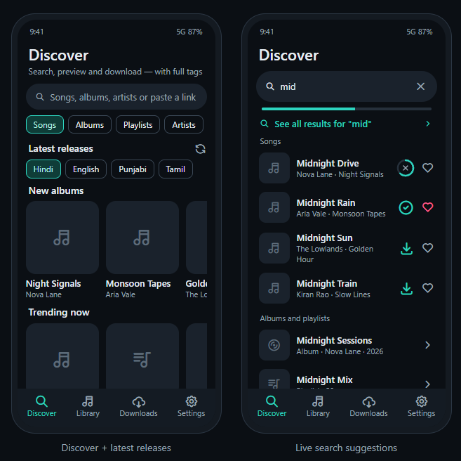
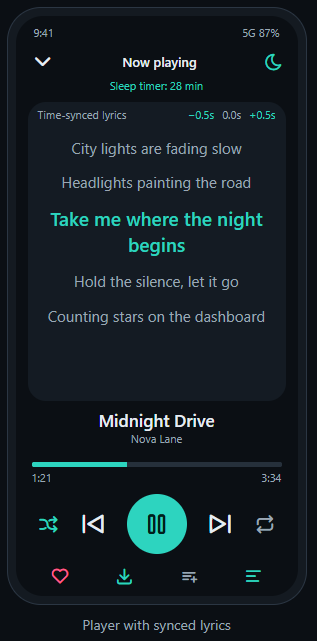
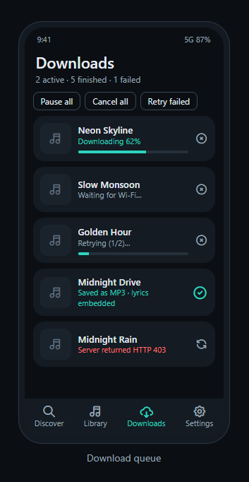
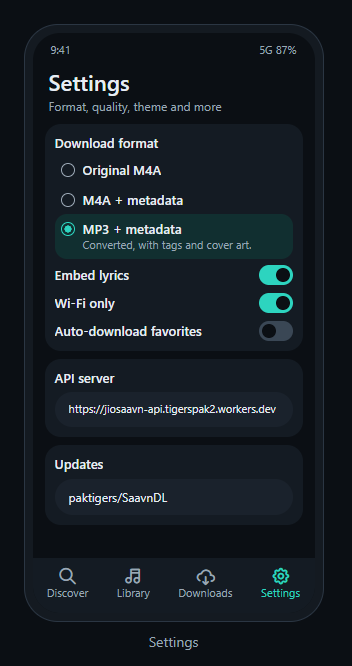
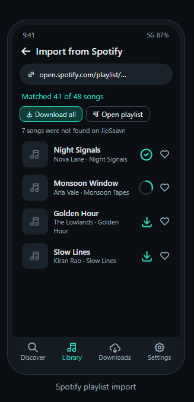

[Live design preview]
(https://paktigers.github.io/SaavnDL/)

## Screenshots
| Discover | Player | Downloads | Settings | Spotify |
|---|---|---|---|---|
|  |  |  |  |  |

# SaavnDL (Android)

Jetpack Compose app on top of the open-source `jiosaavn-api` (default server: https://saavn.sumit.co).

## Build the APK (GitHub Actions)
1. Upload **everything inside this folder** to your repo (keep `.github/workflows/build.yml` and `scripts/`).
2. Every push to `main` (or *Run workflow*) builds the APK **and publishes it as a GitHub Release**
   (`v1.0.<run number>`, file `SaavnDL.apk`). The latest APK is always at
   `https://github.com/<owner>/<repo>/releases/latest`. It is also attached to the run as an artifact.
3. The workflow first cross-compiles LAME (`scripts/build_lame.sh`) for the **MP3 encoder**. If that step fails the app is
   built without it (MP3 then falls back to tagged M4A).

Add the signing secrets once (see GITHUB_SECRETS.txt) so every build has the same signature and updates install over the old app.

## Features
- Discover: latest releases (albums, trending, playlists by language), live search suggestions with posters,
- Import public Spotify playlists/albums (matched on JioSaavn, saved as a playlist, downloadable)
- Import songs already on the phone; library auto-syncs with storage (deleted files disappear, old downloads are restored)
- Search songs/albums/playlists/artists, live suggestions, language filter, "For you" from your favorites
- Paste or share a JioSaavn link into the app; open artist pages, download all albums
- Full player: background playback, lock-screen/notification controls, seek, shuffle, repeat, sleep timer,
  play next / queue, lyrics (LRCLIB, synced highlighting), home-screen widget
- Downloads: Original M4A, M4A + metadata, MP3 + metadata (tags, cover art, optional lyrics), queue with pause/resume,
  Wi-Fi only, auto-retry, parallel downloads, sub-folders + track numbers, skip existing
- Library: sort, filter, tag editor, duplicate finder, remove missing entries, share/delete; favorites; your own playlists
- Extras: auto-download favorites, backup/restore (JSON), batch import (.txt), CSV export, update checker,
  crash log, Material You / AMOLED themes, English / Urdu / Hindi (main screens)

Songs are saved to `Music/SaavnDL` via MediaStore (Android 10+, no storage permission).

## Logo
The launcher icon is an original design. To use your own, replace `res/drawable/ic_launcher_foreground.xml`.
